<p align="center">
  
</p>
<h1 align="center">Pocket Documents</h1>
<p align="center">
  Scans and files made searchable: OCR into PDF/A, full-text search with filters, tags, correspondents, types, custom fields, rules and a classifier that learns how you file. A Paperless-ngx replacement.<br>
  <b>One binary · one SQLite file · one volume.</b>
</p>
<p align="center">
  <a href="https://github.com/abjelosevic88/pocket-homelab-documents/actions"></a>
  <a href="https://github.com/abjelosevic88/pocket-homelab-documents/pkgs/container/pocket-homelab-documents"></a>
  <a href="LICENSE"></a>
</p>

---

Paperless-ngx is the right idea: scan everything, OCR it, tag it, find it again. It is also a Django app with Celery, Redis, PostgreSQL and a Python toolchain, and it keeps every person's papers in one pile with a permissions layer on top. Pocket Documents keeps the idea and drops the rest: a Go binary, one SQLite file, OCRmyPDF and Poppler in the same container, and every person's archive strictly their own.

- **OCR you can trust.** Every PDF, scan and photo becomes a PDF/A with a text layer (OCRmyPDF + Tesseract, any languages), kept next to the untouched original. Skip pages that already have text, redo bad text layers, or force a full re-OCR per document. Office files, HTML, Markdown and e-mails are read natively; with a Gotenberg container they get a PDF twin too.
- **Search that understands the paper.** SQLite FTS5 with BM25 ranking over the text, title, notes, tags and names, with highlighted passages; word beginnings match, and substrings are tried when nothing else does (`nvoic` finds invoices). One box takes it all: `ikea tag:receipts created:2024 -tag:paid "amount due"`. Facet counts next to every filter; sort by anything; save a search as a view for the sidebar and dashboard.
- **Filing that learns.** Tags, correspondents, document types and storage paths are assigned by matching rules (any / all words, phrase, regex, fuzzy) or by a classifier trained on how you filed the last ones, shown as suggestions with a confidence and applied in one tap. Rules add the rest: *file name like `*ikea*` → correspondent IKEA, tag Receipts, title `IKEA {created}`*. The document's date is read off the paper.
- **Your documents folder, where you want it.** Each person can point the app at a folder in their **Pocket Files** (through Pocket Core), their **Nextcloud** (through Pocket Core or an app password), on a **WebDAV** server, or on the server (a NAS mount). The app keeps one readable file per document there, laid out by storage path (`2026/IKEA/2026-03-14 Sofa.pdf`), renamed and re-filed as the document changes, so the archive is browsable and synced without this app. The folder's **Inbox** works the other way: drop a scan in from Pocket Files or the Nextcloud phone app and it becomes a document. A consume folder on the server does the same for scanners.
- **Everything else you expect.** Archive serial numbers, custom fields (money, dates, choices, document links…), notes, full history per document, trash with retention, public share links, bulk edit with shift-select, duplicate detection, a processing queue with logs and retries, keyboard shortcuts, dark mode, an installable PWA that accepts shared photos from the phone.
- **Paper tools.** Rotate, delete or split pages, merge documents, replace a file; every change keeps the old file as a version you can get back. Barcodes: an ASN label sets the serial number, a separator sheet splits a batch scan. Mail accounts with rules turn attachments into documents. Scheduled rules fire on a date ("30 days before the field *Expires*") and can message you.
- **Serbian, properly.** Serbian Latin and Cyrillic models from tessdata_best ship in the image, more languages install from Settings without a rebuild, and search transliterates: `racun` finds `рачун` and the other way round. Dates like "14. марта 2024." are read.
- **Share a document, not your archive.** Give one person on the box view or edit on one document; they see it under "Shared with me" and nothing else of yours.
- **Paperless clients keep working.** The Paperless-ngx REST API is served at `/api/…`, so Paperless-Mobile, Swift Paperless and your scripts point at this box unchanged.
- **Moving in.** Import from a running Paperless-ngx over its API (documents, tags, correspondents, types, paths, custom fields, notes) or from a `document_exporter` zip. Export everything of yours as one zip that imports anywhere.
- **Strictly per person.** Accounts own their documents, labels, fields, rules and views; admins manage users and OCR settings and see nothing else. With **Pocket Core** on the box: single sign-on, `documents.*` events on the bus, paired-phone tokens, *Book in Pocket Money* for invoices and receipts, and the documents folder in **Pocket Files**.

<p align="center">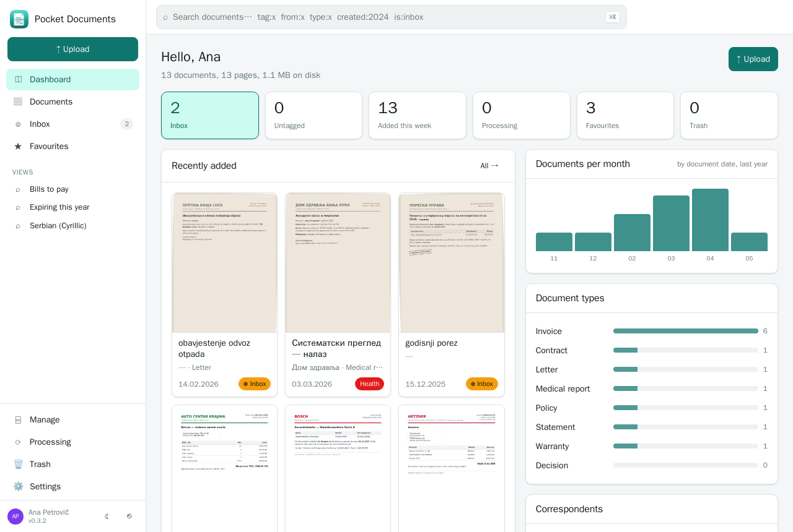</p>

<table>
  <tr>
    <td width="50%">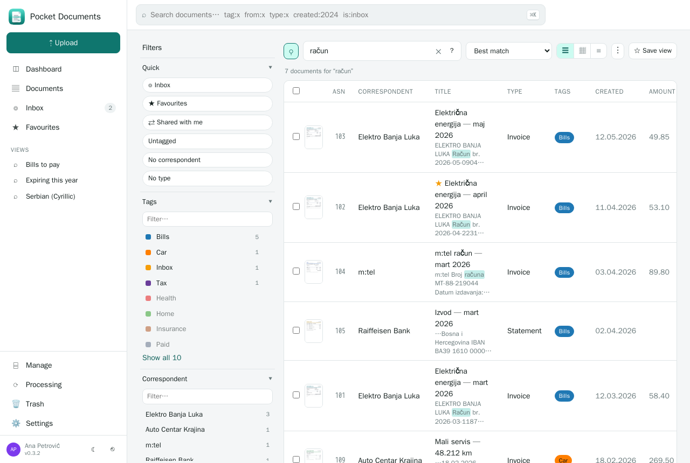</td>
    <td width="50%">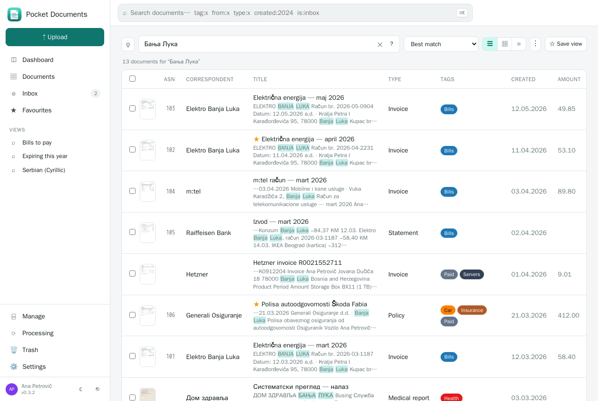</td>
  </tr>
  <tr>
    <td align="center"><sub>Search: full text with highlighted passages and facet counts on every filter.</sub></td>
    <td align="center"><sub>Serbian in both alphabets: <code>Бања Лука</code> finds <i>Banja Luka</i> and the other way round.</sub></td>
  </tr>
  <tr>
    <td width="50%">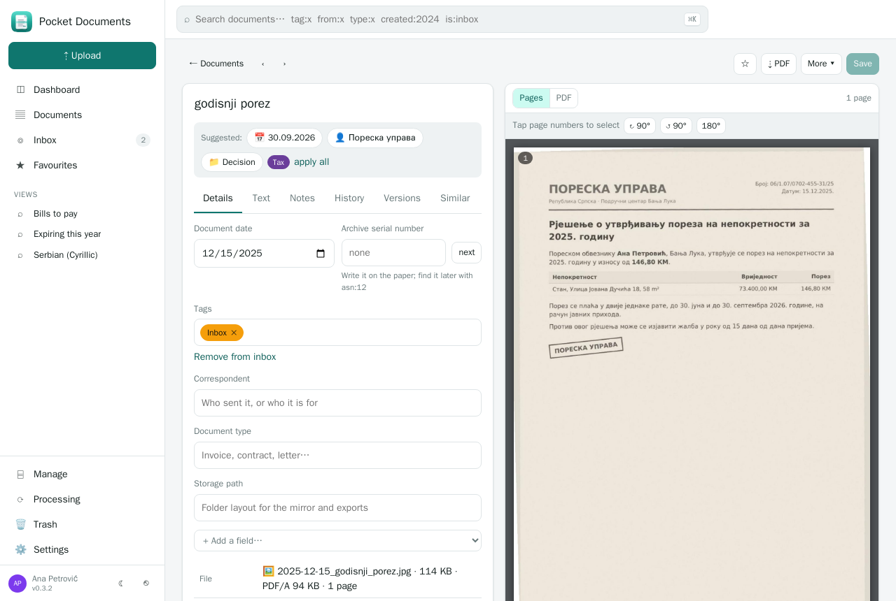</td>
    <td width="50%">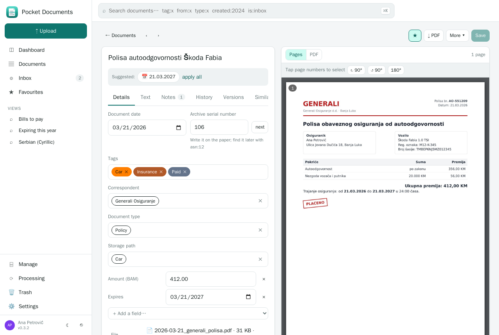</td>
  </tr>
  <tr>
    <td align="center"><sub>A phone photo of a Cyrillic letter, OCR'd; suggestions to file it in one tap.</sub></td>
    <td align="center"><sub>A filed document: labels, custom fields, notes, history, versions.</sub></td>
  </tr>
  <tr>
    <td width="50%">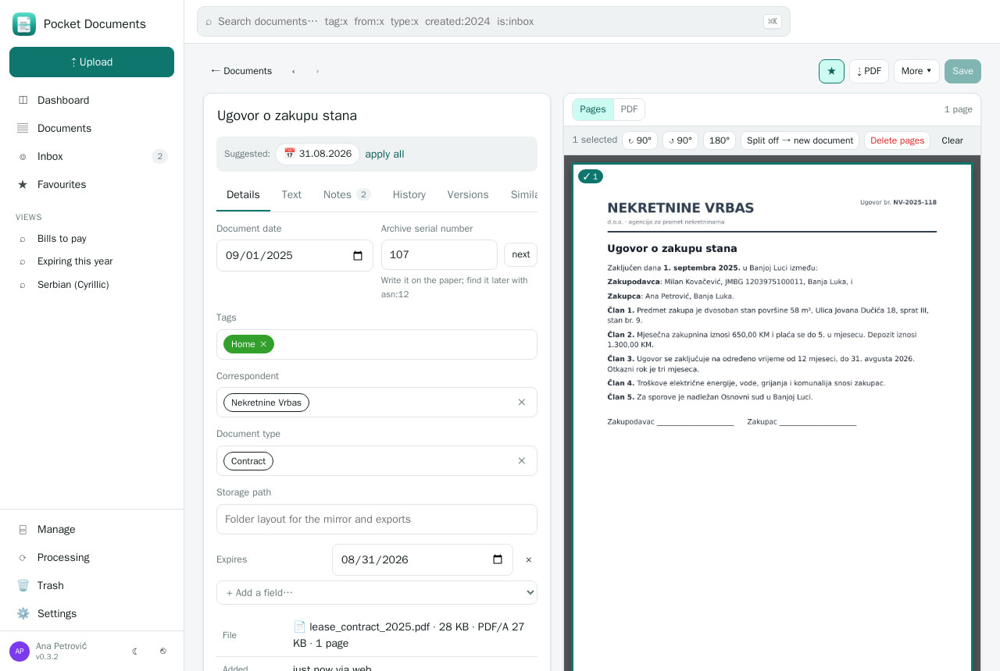</td>
    <td width="50%">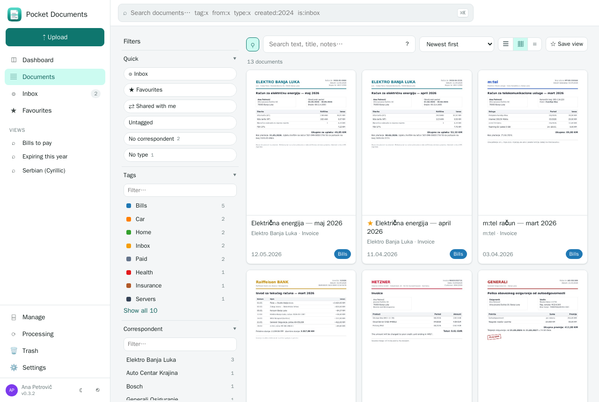</td>
  </tr>
  <tr>
    <td align="center"><sub>Page tools: rotate, split off, delete; the old file stays as a version.</sub></td>
    <td align="center"><sub>Cards, table or list.</sub></td>
  </tr>
  <tr>
    <td width="50%">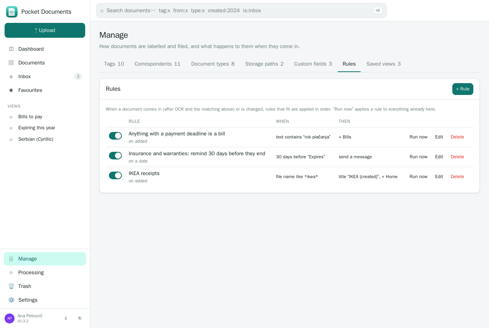</td>
    <td width="50%">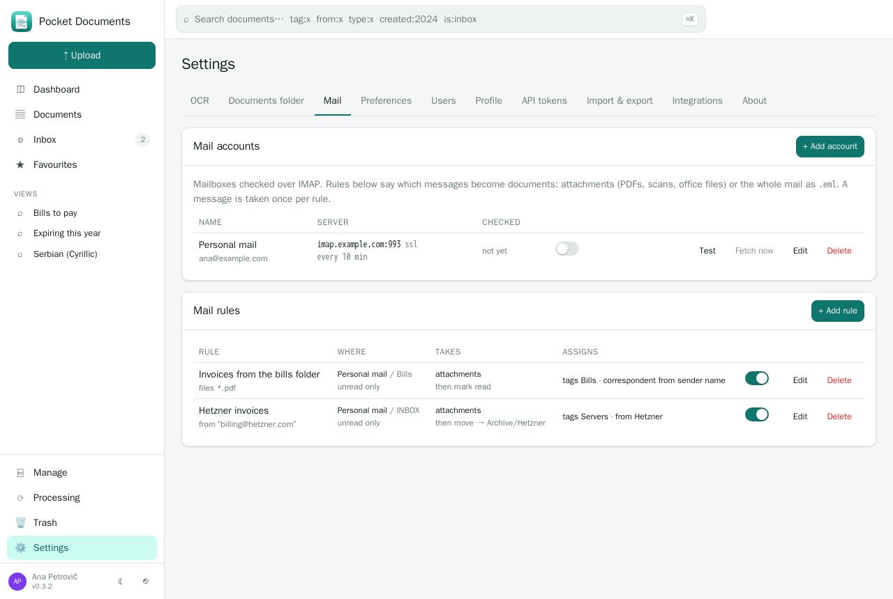</td>
  </tr>
  <tr>
    <td align="center"><sub>Rules when a document comes in, changes, or a date comes near.</sub></td>
    <td align="center"><sub>Mail: IMAP accounts and rules turn attachments into documents.</sub></td>
  </tr>
  <tr>
    <td width="50%">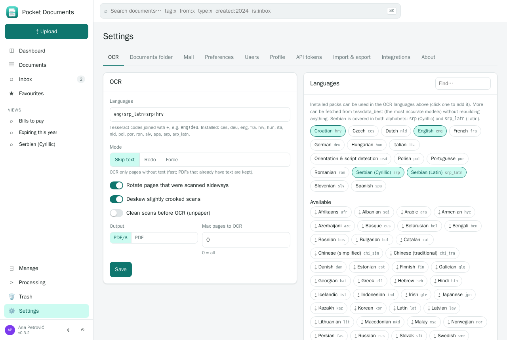</td>
    <td width="50%">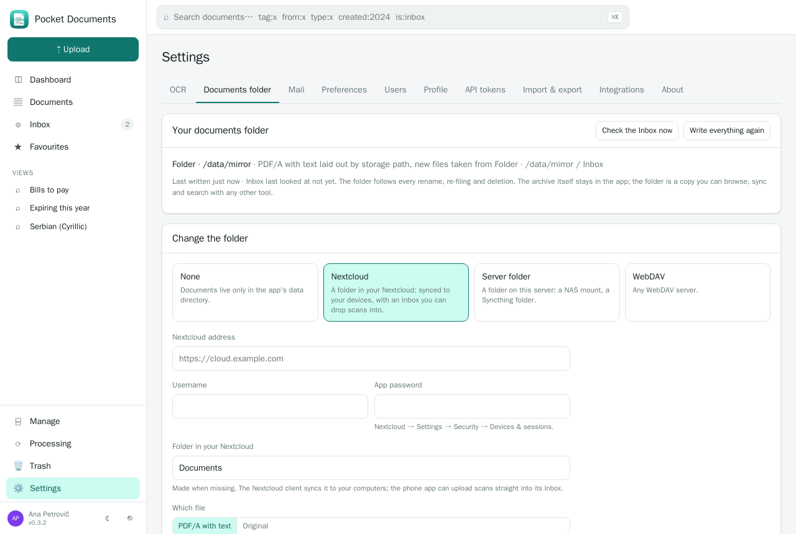</td>
  </tr>
  <tr>
    <td align="center"><sub>OCR languages; more packs install from here without a rebuild.</sub></td>
    <td align="center"><sub>Your documents folder in Nextcloud, WebDAV or on the server, with an Inbox.</sub></td>
  </tr>
  <tr>
    <td width="50%">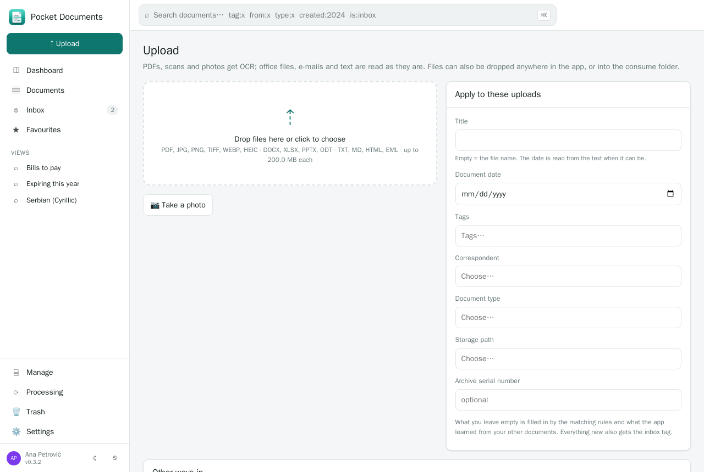</td>
    <td width="50%">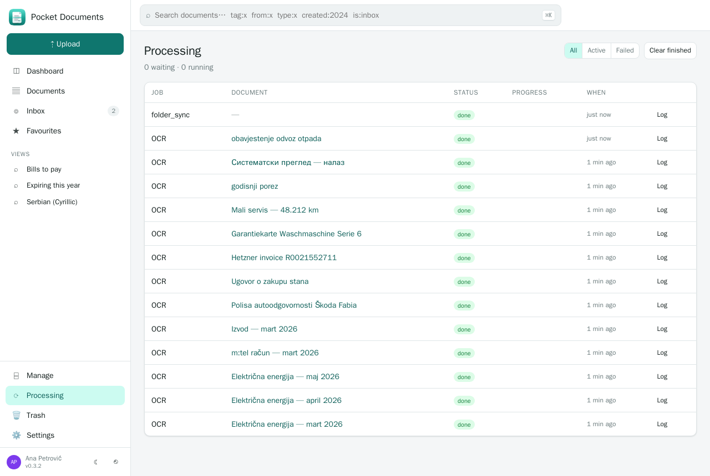</td>
  </tr>
  <tr>
    <td align="center"><sub>Upload: drop anywhere, label the batch, or take a photo.</sub></td>
    <td align="center"><sub>Processing: each OCR job with its full log.</sub></td>
  </tr>
</table>

<p align="center">
  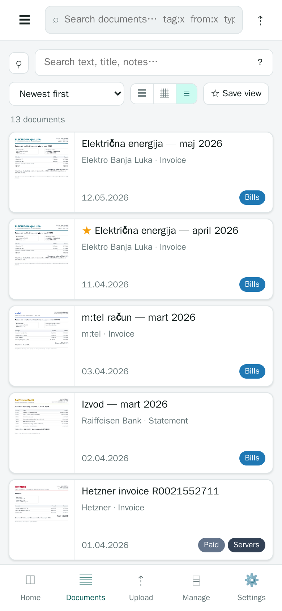&nbsp;&nbsp;
  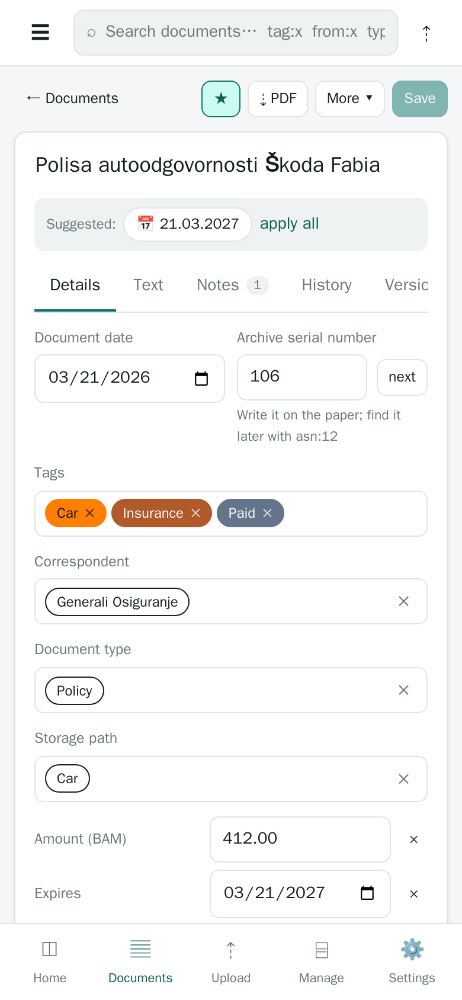&nbsp;&nbsp;
  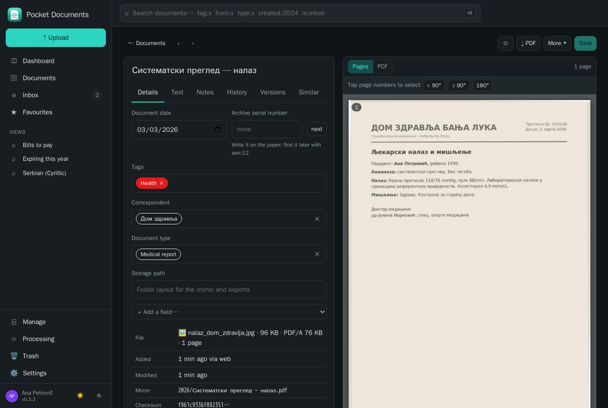<br>
  <sub>An installable PWA (share a photo to it from the phone), plus dark mode. Every name and number in these screenshots is made up.</sub>
</p>

## Run it

```bash
mkdir pocket-documents && cd pocket-documents
curl -fsSLO https://raw.githubusercontent.com/abjelosevic88/pocket-homelab-documents/main/docker-compose.yml
docker compose up -d
# open http://localhost:8080 and create your account
```

Or with plain Docker:

```bash
docker run -d --name pocket-documents -p 8080:8080 -v ./data:/data -e TZ=Europe/Berlin -e OCR_LANGUAGE=eng+deu \
  ghcr.io/abjelosevic88/pocket-homelab-documents:latest
```

Want to look around first? Add `-e DEMO_DATA=true -e AUTH_MODE=none` for sample documents and no login.

The image carries OCRmyPDF, Tesseract (with the language packs listed in the Dockerfile's `OCR_LANGS`), Ghostscript, Poppler and unpaper. The bare binary from the [releases](https://github.com/abjelosevic88/pocket-homelab-documents/releases) needs `ocrmypdf` and `poppler-utils` on the host; without them it still stores and indexes documents that carry text.

## How it works

```
upload / consume folder / API ──► originals/<id>.pdf ──► queue ──► OCRmyPDF ──► archive/<id>.pdf (PDF/A + text layer)
                                                                   │             pdftotext ──► content ──► FTS5 index
                                                                   │             pdftoppm ──► thumbnail, page images
                                                                   └─► date from text · matching rules · classifier · your rules · mirror folder · events
```

Documents live in `DATA_DIR` as plain files named by id; the database has the rest. Back up the directory and you have everything ([docs/backup.md](docs/backup.md)).

## Configuration

Everything is an environment variable with a sensible default. The ones that matter:

| Variable | Default | Notes |
|---|---|---|
| `OCR_LANGUAGE` | `eng` | Tesseract codes joined with `+`. Changeable in Settings. |
| `OCR_MODE` | `skip` | `skip` / `redo` / `force`; see [docs/configuration.md](docs/configuration.md). |
| `OCR_WORKERS` | `1` | Documents processed at once. |
| `GOTENBERG_URL` | – | Office documents get a PDF twin through [Gotenberg](https://gotenberg.dev). |
| `CONSUME_DIR` / `MIRROR_DIR` | `DATA_DIR/consume`, `DATA_DIR/mirror` | The watched folder; the browsable copy. |
| `AUTH_MODE` | `local` | `local` (login, multi-user), `proxy` (trust your SSO proxy's header), `none` (no login, trusted LAN). |
| `ADMIN_EMAIL` / `ADMIN_PASSWORD` | – | Create the first admin without the setup screen. |
| `BASE_URL` / `SECURE_COOKIES` | – / `false` | Set both behind HTTPS. |
| `CORE_URL` / `CORE_REGISTRATION_KEY` | – | Join a Pocket Core. |

The full list, the auth modes, OIDC and the data layout: [docs/configuration.md](docs/configuration.md). The REST API and the search syntax: [docs/api.md](docs/api.md).

## Develop

```sh
make dev     # API on :8080 with demo data and no login, Vite on :5173
make test    # go vet + go test (the server tests run the whole upload → OCR → search flow with text files) + tsc
make all     # web + binary with the UI embedded
make docker  # the image with the OCR toolchain
```

Go 1.26, React 19, chi, modernc SQLite (no cgo). OCR by [OCRmyPDF](https://ocrmypdf.readthedocs.io) and Tesseract, rendering by Poppler.

## License

MIT.
